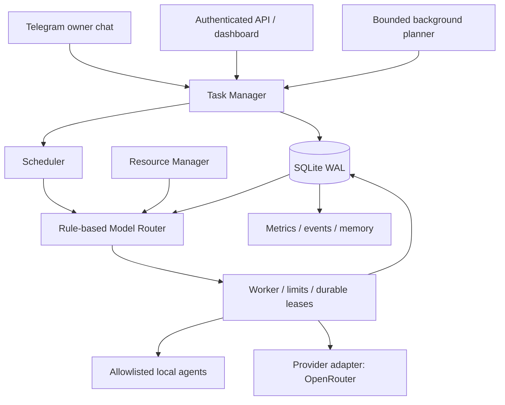

# Кумулятивная агентная система

## Исходное состояние и решения

Исследование 2026-10-01: `/workspace` пуст, существующих прикладных компонентов
нет. Доступная машина — Debian 13 x86_64, Python 3.12; целевой сервер пользователя
— Ubuntu 24.04 ARM64. SSH, OpenRouter и Telegram credentials не предоставлены.
Разработка и проверка выполняются здесь; deployment на целевой сервер отдельный
шаг после предоставления подключения. Никакие существующие сервисы не меняются.

Python 3.12 + FastAPI + SQLite WAL, HTTPX, Pydantic, YAML. Один сервис с одним
ASGI worker; Redis и отдельный broker не нужны. Async event/timer scheduler
просыпается при создании задачи, завершении run и периодическом housekeeping.
SQLite — источник истины: tasks, dependencies, runs, reservations, usage, events,
projects, providers, models, discoveries, memory, attachments, approvals, settings.
Repository централизует соединение, transactions и storage primitives. В MVP
services ещё содержат SQL для статистики и atomic claim; это не drop-in
PostgreSQL adapter. При переходе нужны typed query/claim methods в repository,
JSON-query adaptation и миграции. Domain/provider/agent interfaces сохраняются.

## Интерфейсы и ответственность

* `Repository`: transactions, schema migration, query/write storage boundary.
* `TaskManager`: lifecycle, dependency validation, attachments, retries, history,
  approvals; no raw agent execution.
* `Scheduler`: selection/score, dependencies and server pressure; no LLM calls.
* `ResourceManager`: machine snapshot, persistent quota/manual tracking and
  model registry; authoritative budget reservation happens atomically on claim.
* `Router`: capability/context eligibility, model price, measured reliability,
  human quality and latency. Exposes decision reasons, never hidden CoT.
* `Provider` protocol: completion -> normalized text/usage/cost; initial OpenRouter
  and deterministic mock provider for tests. No Codex subscription scraping:
  manual resources are visible but not executable without an official adapter.
* `Worker`: claim, heartbeat, timeout, bounded steps/tokens/cost, result and recovery.
* `Planner`: deterministic useful local jobs, cooldown, value threshold, dedup and
  maximum background backlog. Does not ask an LLM to invent work endlessly.
* `Agent` protocol: local metrics analysis, metadata indexing and project TODO
  reports; generic user/research/analysis tasks use configured LLM.
* `Telegram`: owner-only private chat, durable update cursor/idempotent task
  creation. Natural text becomes a user task; commands query/control the queue.
* `API`: bearer or verified Telegram initData auth, tasks/resources/projects/usage/
  approvals, read-only monitoring dashboard; `/app` serves a mobile task editor.

## Scheduling and routing

Eligible user tasks form the first scheduling tier; background tasks can start
only if no runnable user tasks exist. Running calls finish within their timeout;
there is no unsafe preemption. Already-blocked or unmet-dependency user tasks do
not prohibit useful background work. For each tier:

`score = 10*priority + deadline_urgency(0..100) + 5*value(0..20)
         - 2*estimated_cost(0..20) + age_hours(0..24)
         + background_quota_expiry_bonus(0..30)`

Expiry bonus requires an executable matching model, actual positive remaining
quota and an upcoming reset. Never overrides the user tier or hard budgets.
Router is a replaceable strategy: initially expected quality, historical success,
latency, cost and quota expiry; later learned routing can use the same usage data.
Explicit preferred model is respected; capabilities and full prompt/context
limits remain mandatory. Model/provider allowlists are config based.

## Recoverability and limits

Runs acquire an atomic transaction: concurrency cap, daily/global background
budget, task total budget across retries, token quota and rate limits checked
together. Maximum call cost is reserved before sending a request. Model prices
are per million tokens; UTF-8 byte bound conservatively estimates input. Output
cap is sent to the provider. Missing usage/timeout/connection loss may have billed:
charge reserved cost/tokens conservatively, do not refund unknown remote calls.
Healthy runs heartbeat. Expired leases become failed attempts and bounded retries;
their reserved cost remains charged. Dependencies on failed/blocked tasks remain
blocked. Retry cannot bypass task or daily caps.

`max_steps`, `max_tokens`, `max_cost`, `timeout_seconds`, `max_attempts` are bounded
per task and clamped by global config. MVP LLM execution is exactly one completion,
without tool loops. Global `max_concurrent_agents`, daily/background cost, prompt
size, server disk/memory pressure checks are enforced. Quota manual corrections
are authoritative operator changes, not a mechanism to evade provider limits.
Reset may replenish a quota only when its configured period is known.

Configured pricing cannot guarantee a hard monetary cap if the provider changes
prices or reports inaccurate usage. Provider max-price routing and conservative
reservations reduce risk; configure an OpenRouter API-key credit cap as the final
financial boundary. A zero global budget disables paid calls by default.

## Security and data boundaries

Secrets only env/.env (ignored); no values in logs, API responses or git. API binds
127.0.0.1 by default, requires token, docs disabled. Dashboard token lives in
browser session memory, never URL. Mini App checks bot-token HMAC, auth_date and
owner allowlist on every request, uses optimistic edit versions and safe text
rendering; only its shell may embed inside Telegram web frames. Telegram owner
allowlist fails closed; groups ignored. Opt-in first-private-text bootstrap claims
one owner atomically in SQLite; API calls cannot claim an owner. Explicit config
IDs override the stored claim, which otherwise survives restarts. Chat replies,
result notifications, Mini App auth and resource readiness share the same owner
lookup. Only requested bot replies go to authorized user chats.

The Ubuntu installer publishes HTTPS through Nginx while ASGI stays on loopback.
Public IPv4 TLS uses Certbot ≥5.4 webroot and Let's Encrypt shortlived profile;
HTTP serves only ACME challenge/redirect, certificate renewals have a persistent
twice-daily systemd timer. Without successful TLS, public API exposure stays off.

User-supplied task description is sent to a selected provider when configured.
Local background reports, paths and file contents are not automatically sent to
third parties. File indexing is opt-in per project, metadata only, excludes
symlinks, secrets, VCS, dependencies and huge files, never deletes files. Attachments
are metadata; no arbitrary filesystem serving. Retrieval only includes relevant
explicitly `share_with_llm` memory, capped by count/bytes and project scope.

MVP has no general shell, browser, destructive tools, deployments, account creation,
payments or outbound messaging agent. Dangerous proposed actions create a blocked
task and approval record; approving a proposal does not execute it. Production
workflow extension: committed read-only source -> isolated snapshot/worktree ->
validated patch -> configured sandboxed tests -> review artifacts and proposal.
`CodingWorkflow`, `TestSandbox`, `ResourceObserver`, local `Intake`, `Reminders`
are separate modules. Production repositories cannot be written or merged by them.
No scraping quotas, multiaccounting, free-tier abuse or automatic signup.

## Delivery boundary

MVP includes persistent tasks, dependencies/subtasks, history/results/attachments,
retries, reservations, scheduler/router, OpenRouter adapter, local agents, Telegram,
manual resource tracking, structured logs/metrics, bounded planner, projects,
scoped memory, read-only dashboard, Docker/systemd examples and meaningful tests.
Semantic file search, trained learned routing, general web resource discovery,
multi-provider credentials and PostgreSQL are explicit future milestones, not
claimed as production-ready features.

Sequential extensions are described in [PROJECT_WORKFLOWS.md](docs/PROJECT_WORKFLOWS.md).
Run stages, artifacts, checkpoints, notification outbox, resource observations
and evaluation sources use additive tables. Background stages yield durable
checkpoints without rerunning paid LLM calls. Resource observations are tasks;
changed prices require operator config review, and cooldowns survive restarts.
